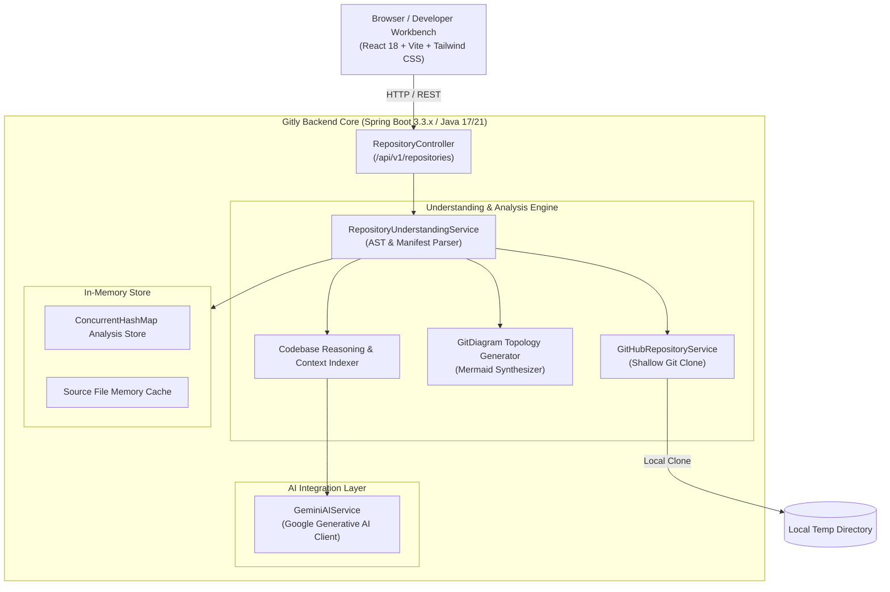

# Gitly AI — Visual Repository Intelligence & Codebase AI Platform

> **Understand any unfamiliar GitHub repository visually. Onboard faster with automated architecture topologies, AST symbol extraction, and interactive diagram-generating Gitly AI chat.**

---

## 📌 Overview

**Gitly AI** is an open-source visual codebase intelligence platform built to help software engineers and developers understand complex, unfamiliar codebases effortlessly.

By simply providing a public GitHub repository URL, Gitly clones the tree, performs static AST and manifest code analysis across multiple programming languages, synthesizes interactive **GitDiagram-style visual system topologies**, maps data models, and provides **Gitly AI** — a conversational copilot that can explain architecture, audit dependencies, break down APIs, guide developer onboarding, and synthesize custom visual Mermaid diagrams on demand.

---

## ✨ Key Capabilities

1. **GitDiagram-Style Interactive Visual Architecture**:
   - Automatically clusters discovered components into functional tiers: *Entry & Routing*, *Views & UI*, *Core Services & Logic*, and *Data Access & Persistence*.
   - Renders live interactive SVG topologies via Mermaid with zoom, pan, reset, and raw source export.
   - Connects components using real static import relationships (`import`, `from X import Y`).

2. **Gitly AI Codebase Assistant (with Live Diagram Synthesis)**:
   - Ask natural language questions about any file, workflow, authentication mechanism, or database query.
   - **Generates Diagrams on the Fly**: Whenever requested, Gitly AI creates valid Mermaid diagrams that render interactively inside the chat stream.
   - Built-in default deep-dive prompts for **Components & Architecture**, **APIs & Route Handlers**, **Dependencies Audit**, **5-Day Onboarding Guide**, and **Data Models**.
   - Integrates Google Gemini LLMs with automatic multi-model fallback (`gemini-3.5-flash`, `gemini-3.5-flash-lite`, `gemini-2.5-flash`) + offline reasoning engine.

3. **Deep Polyglot Code Intelligence**:
   - **Java & Spring Boot**: Detects `@RestController`, `@Service`, `@Repository`, `@Entity`, and mapped HTTP routes.
   - **Python**: Detects Streamlit views, FastAPI/Flask route handlers, function definitions (`def ...`), and Firestore/SQL queries.
   - **TypeScript & React / Next.js**: Maps page routes, UI components, custom hooks, and state context providers.
   - **Go, Rust, C#, PHP**: Extracts primary modules and ecosystem packages.

4. **Interactive File & Module Explorer**:
   - Interactive folder and file tree with automatic role summaries explaining what each file and directory is responsible for.

5. **Data & Persistence Layer**:
   - Deep inspection of database technologies, models, collections, and Entity-Relationship diagrams.

6. **Zero-Database Lightweight Deployment**:
   - Runs in-memory with zero external database dependencies (PostgreSQL/Redis are not required).

---

## 🏗️ System Architecture



---

## 🚀 Quickstart Guide

### Prerequisites
- **Java 17** or **Java 21**
- **Apache Maven 3.8+**
- **Node.js 18+** and **npm**
- **Git** installed and available in your `PATH`
- *(Optional)* Free Google Gemini API Key from [Google AI Studio](https://aistudio.google.com/)

---

### Option 1: Run Locally (2 Terminals)

#### 1. Start the Spring Boot Backend
```bash
cd backend

# Optional: Set your Gemini API key (or set it directly in the web UI)
export GEMINI_API_KEY="your_api_key_here"      # Linux / macOS
$env:GEMINI_API_KEY="your_api_key_here"         # Windows PowerShell

mvn spring-boot:run
```
* Backend runs at: `http://localhost:8080`
* Swagger UI Docs: `http://localhost:8080/swagger-ui.html`

#### 2. Start the React Frontend
```bash
cd frontend
npm install
npm run dev
```
* Open `http://localhost:3000` in your browser.

---

### Option 2: Run with Docker Compose

```bash
cd docker
docker compose up --build
```
Both backend (`:8080`) and frontend (`:3000`) will build and run in coordinated containers.

---

## 📡 REST API Reference

| Method | Endpoint | Description |
|---|---|---|
| `GET` | `/api/v1/repositories/health` | Health status and Gemini AI configuration check |
| `POST` | `/api/v1/repositories/config/api-key` | Set/update Gemini API key dynamically at runtime |
| `POST` | `/api/v1/repositories/analyze` | Clone and analyze a GitHub repository |
| `GET` | `/api/v1/repositories` | List all analyzed repositories in session |
| `GET` | `/api/v1/repositories/{id}` | Get full repository analysis payload |
| `GET` | `/api/v1/repositories/{id}/architecture` | Get visual architecture Mermaid diagram & layers |
| `GET` | `/api/v1/repositories/{id}/structure` | Get interactive folder & file tree |
| `GET` | `/api/v1/repositories/{id}/workflows` | Get execution sequence diagrams |
| `GET` | `/api/v1/repositories/{id}/components` | Get discovered classes, hooks, and modules |
| `GET` | `/api/v1/repositories/{id}/apis` | Get discovered HTTP endpoints and route handlers |
| `GET` | `/api/v1/repositories/{id}/database` | Get detected database technologies & models |
| `GET` | `/api/v1/repositories/{id}/onboarding-guide` | Get customized 5-day developer onboarding plan |
| `POST` | `/api/v1/repositories/{id}/chat` | Ask questions about the codebase |

---

## 📁 Repository Structure

```text
codeintel-ai/
├── backend/
│   ├── pom.xml
│   ├── Dockerfile
│   └── src/
│       ├── main/
│       │   ├── java/com/repomind/
│       │   │   ├── RepoMindApplication.java
│       │   │   ├── config/          # CORS & environment configuration
│       │   │   ├── controller/      # REST API endpoints
│       │   │   ├── dto/             # Analysis result & request models
│       │   │   ├── exception/       # Global exception handlers
│       │   │   └── service/         # AST scanner, Git engine, and Gemini AI client
│       │   └── resources/
│       │       └── application.yml
│       └── test/                    # Unit & integration test suites
├── frontend/
│   ├── package.json
│   ├── vite.config.ts
│   ├── Dockerfile
│   └── src/
│       ├── App.tsx                  # Developer workbench & GitDiagram canvas
│       ├── main.tsx
│       └── index.css                # Clean, anti-slop developer typography
├── docker/
│   └── docker-compose.yml           # Full-stack container orchestration
├── docs/
│   ├── ARCHITECTURE.md              # Deep architectural specification
│   └── SETUP_GUIDE.md               # Step-by-step developer setup
└── LICENSE                          # MIT License
```

---

## 🛡️ License

This project is licensed under the [MIT License](LICENSE).
