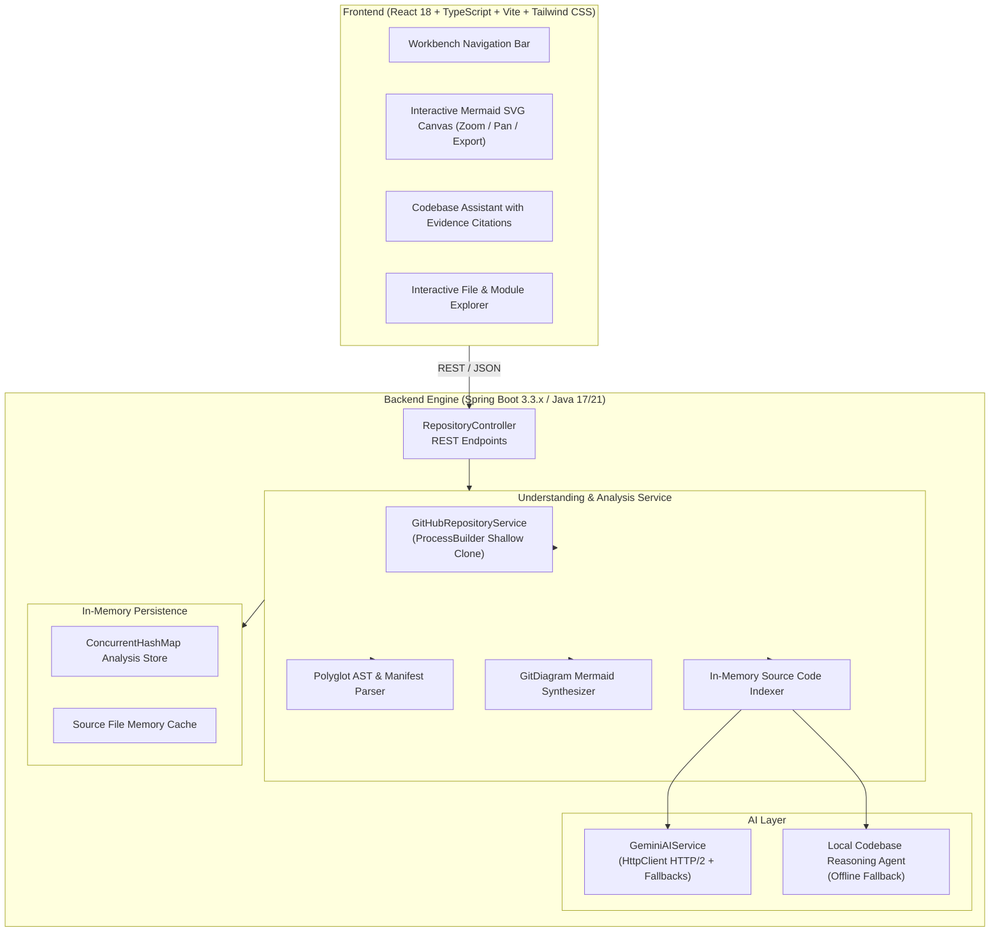

# RepoMind AI — Technical Architecture

## 1. System Overview

RepoMind AI is designed as a modular service architecture that bridges deterministic static code analysis with Large Language Model (LLM) reasoning to understand any GitHub codebase across multiple languages.

---

## 2. Key Components & Implementation

### 1. `com.repomind.service.GitHubRepositoryService`
- Extracts normalized `owner/repo` identifiers from diverse URL formats.
- Executes safe, shallow clones (`git clone --depth 1`) using Java `ProcessBuilder` into the local temporary directory.
- Manages directory creation and safe cleanup.

### 2. `com.repomind.service.RepositoryUnderstandingService`
- **Recursive Directory Scanner**: Traverses directory structures up to 14 levels deep while pruning non-source noise (`.git`, `node_modules`, `target`, `build`, etc.).
- **Polyglot Source Code Inspector**:
  - Python: Functions (`def`), routes (`@app.get`), Streamlit views, and Firestore/SQL collections.
  - TypeScript/JavaScript: Component declarations, hooks, routes, and interfaces.
  - Java/Kotlin: Spring stereotypes (`@RestController`, `@Service`, `@Repository`, `@Entity`) and HTTP mappings.
- **Dependency & Manifest Profiler**: Reads `package.json`, `pom.xml`, `build.gradle`, and `requirements.txt`.
- **GitDiagram Topology Synthesizer**: Groups discovered components into architectural tiers and maps directional dependency edges based on actual static `import` declarations.

### 3. `com.repomind.service.GeminiAIService`
- Connects directly to Google's Generative Language API via standard Java `HttpClient` without heavy third-party SDK dependencies.
- Implements an automated fallback chain (`gemini-2.5-flash`, `gemini-2.0-flash`, `gemini-1.5-flash-latest`, `gemini-pro`).
- Allows dynamic API key updates at runtime via `/api/v1/repositories/config/api-key`.

### 4. `com.repomind.controller.RepositoryController`
- Exposes clear, RESTful OpenAPI/Swagger-documented endpoints for repository analysis, structure inspection, workflow generation, and conversational Q&A.
